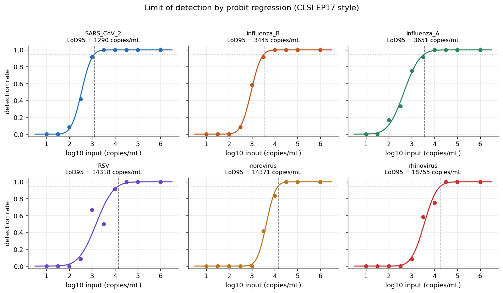
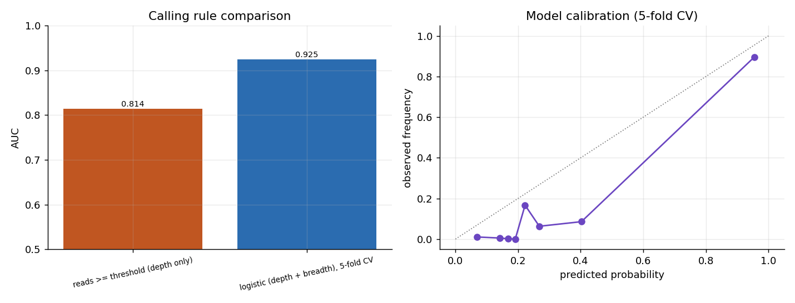

# respiratory-panel-eval

A reproducible framework for evaluating a Nanopore metagenomic panel that
detects respiratory pathogens (influenza A/B, RSV, rhinovirus, norovirus,
SARS-CoV-2). It takes a per-sample count matrix and validates it the way a
clinical laboratory validates a diagnostic assay: detection limits, test
accuracy with confidence intervals, quantitative agreement, and a learned
calling rule benchmarked honestly against a simple threshold.

## Why this exists

Rapid, sequencing-based diagnostics are central to pandemic preparedness, and
before such a platform is trusted it has to be characterised: how little
template can it detect, how often does it call a pathogen that is not there,
and does a learned decision rule actually beat the obvious one. This repository
is a compact, end-to-end answer to those questions, built so that every number
and figure is reproduced by a single script.

It was written as a portfolio piece aligned with the FWO-SBO project ANTICIPATE
at VUB / UZ Brussel, whose work package covers the evaluation of an extraction
procedure and a genomic diagnostic platform for respiratory pathogens.

## What it measures

- Detection accuracy (sensitivity, specificity, PPV, NPV, F1, accuracy) with
  Wilson score intervals, reported both at clinically relevant load and pooled
  across the full dilution series.
- Per-pathogen discrimination by ROC and AUC.
- Limit of detection (LoD95) by probit regression on the dilution series, in
  the spirit of CLSI EP17, with a delta-method interval on each LoD.
- Quantitative agreement between read depth and known input load, via
  correlation and a Bland-Altman analysis.
- A learned calling rule (logistic regression on read depth and genome
  breadth), scored by cross-validation and compared to the depth-only threshold
  at matched sensitivity. The gain comes from rejecting high-depth, low-breadth
  pileups that the depth rule accepts.

The rendered results, including all figures, are in
[results/REPORT.md](results/REPORT.md).

## Results at a glance

On the committed example data, detection at clinically relevant load reaches a
sensitivity near 0.98 at a specificity near 0.97, LoD95 values range from about
1.3k to 46k copies/mL across the six targets, and the breadth-aware rule lifts
AUC from 0.81 to 0.92 while raising PPV from 0.76 to 0.99 at matched
sensitivity.





## Quickstart

```bash
pip install -r requirements.txt
python scripts/run_evaluation.py     # writes results/figures, results/tables, results/REPORT.md
pytest -q                            # sanity tests for the statistics
```

Running with no arguments regenerates the example count matrix if needed and
evaluates it. To evaluate a different matrix (for instance one produced by the
pipeline layer):

```bash
python scripts/run_evaluation.py --counts data/counts.csv
```

## How the data is produced

The evaluation runs on a count matrix with one row per pathogen per sample. Two
ways to obtain one:

1. Simulated (default, no external tools). `src/panel_eval/simulate_counts.py`
   generates a realistic matrix with known ground truth, including a per-target
   dilution series and spurious pileup false positives. This is what the
   committed results use.
2. From reads (optional). The scripts in `pipeline/` download references,
   simulate Nanopore reads with Badread across the dilution series, align with
   minimap2 and count per-pathogen reads and genome breadth. The output has the
   same schema, so the evaluation is identical. See
   [pipeline/README.md](pipeline/README.md).

The committed results are based on simulated data. This is deliberate: it keeps
the whole analysis reproducible on any machine without data-access barriers,
and the ground truth is known exactly, which is what makes an honest LoD and
DTA analysis possible. The statistical methods are the transferable part and
apply unchanged to real sequencing output.

## Repository layout

```
config/panel.yaml            panel definition and simulation parameters
src/panel_eval/              evaluation library
  simulate_counts.py         synthetic count matrix with ground truth
  metrics.py                 DTA metrics, ROC/AUC, kappa
  lod.py                     probit LoD95 with delta-method CI
  agreement.py               calibration, correlation, Bland-Altman
  classifier.py              cross-validated logistic calling rule
scripts/run_evaluation.py    runs everything, writes figures/tables/report
pipeline/                    optional Nanopore pipeline (reads to counts)
data/example_counts.csv      committed synthetic count matrix
results/                     committed figures, tables and REPORT.md
tests/test_metrics.py        sanity tests
```

## Notes

The panel parameters and pileup rate in `config/panel.yaml` are set to produce
a plausible but not trivial evaluation; changing them and re-running shows how
the metrics respond. Random seeds are fixed so results are reproducible.

## License

MIT. See [LICENSE](LICENSE).
