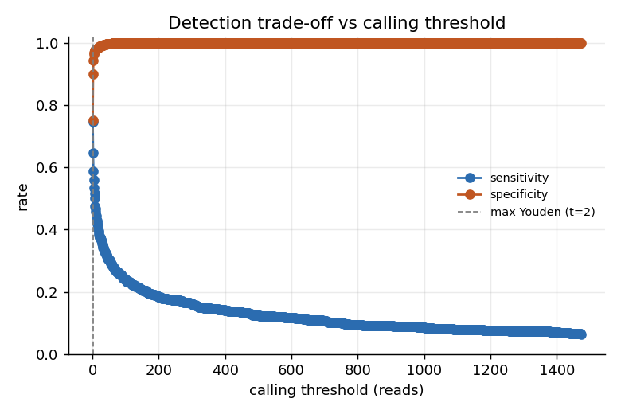
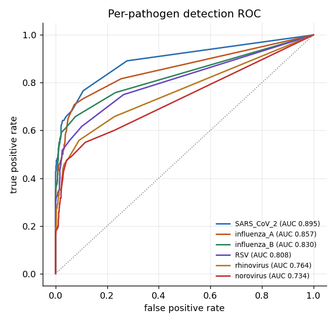
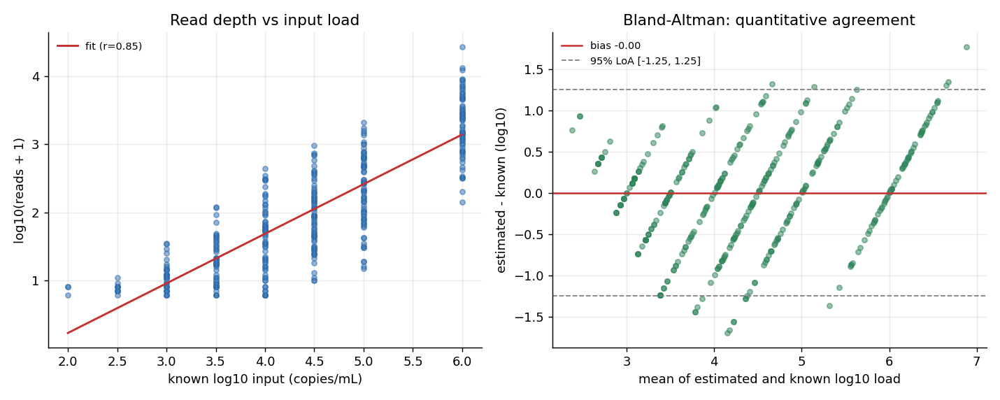

# Respiratory panel evaluation report

Generated from a count matrix of 780 samples across 6 pathogens. All figures and tables below are produced by `scripts/run_evaluation.py`.

## 1. Detection accuracy

At clinically relevant load (>= 1e4 copies/mL) against all pathogen-absent observations:

| metric | estimate | ci_low | ci_high | n |
| --- | --- | --- | --- | --- |
| sensitivity | 0.979 | 0.955 | 0.990 | 288 |
| specificity | 0.970 | 0.964 | 0.975 | 3960 |
| ppv | 0.705 | 0.659 | 0.748 | 400 |
| npv | 0.998 | 0.997 | 0.999 | 3848 |
| accuracy | 0.971 | 0.965 | 0.975 | 4248 |
| f1 | 0.820 |  |  | 406 |

Pooled across the entire dilution series, including concentrations far below any clinical sample (this understates clinical sensitivity by design and is shown for completeness):

| metric | estimate | ci_low | ci_high | n |
| --- | --- | --- | --- | --- |
| sensitivity | 0.533 | 0.497 | 0.570 | 720 |
| specificity | 0.970 | 0.964 | 0.975 | 3960 |
| ppv | 0.765 | 0.726 | 0.800 | 502 |
| npv | 0.920 | 0.911 | 0.927 | 4178 |
| accuracy | 0.903 | 0.894 | 0.911 | 4680 |
| f1 | 0.628 |  |  | 838 |

Cohen's kappa (called vs truth, all pathogens pooled): **0.575**.

Detection rate by input level, pooled across pathogens:

| copies_per_ml | input_log10 | n | detected | detection_rate |
| --- | --- | --- | --- | --- |
| 10 | 1 | 72 | 0 | 0 |
| 32 | 1.500 | 72 | 0 | 0 |
| 100 | 2 | 72 | 3 | 0.042 |
| 316 | 2.500 | 72 | 11 | 0.153 |
| 1000 | 3 | 72 | 36 | 0.500 |
| 3162 | 3.500 | 72 | 52 | 0.722 |
| 10000 | 4 | 72 | 66 | 0.917 |
| 31623 | 4.500 | 72 | 72 | 1 |
| 100000 | 5 | 72 | 72 | 1 |
| 1000000.000 | 6 | 72 | 72 | 1 |

## 2. Per-pathogen discrimination (ROC / AUC)

| pathogen | auc | n | positives |
| --- | --- | --- | --- |
| SARS_CoV_2 | 0.895 | 780 | 120 |
| influenza_A | 0.857 | 780 | 120 |
| influenza_B | 0.830 | 780 | 120 |
| RSV | 0.808 | 780 | 120 |
| rhinovirus | 0.764 | 780 | 120 |
| norovirus | 0.734 | 780 | 120 |

## 3. Limit of detection (LoD95)

Probit fit of detection rate against log10 input, per pathogen, with a delta-method 95% interval on the LoD.

| pathogen | lod_copies | ci_low | ci_high | lod_log10 | slope | converged |
| --- | --- | --- | --- | --- | --- | --- |
| SARS_CoV_2 | 1289.832 | 624.471 | 2664.121 | 3.111 | 2.866 | True |
| influenza_B | 3444.542 | 1667.464 | 7115.517 | 3.537 | 2.866 | True |
| influenza_A | 3651.424 | 1472.843 | 9052.492 | 3.562 | 1.836 | True |
| RSV | 14318.229 | 5532.164 | 37058.135 | 4.156 | 1.678 | True |
| norovirus | 14371.219 | 7181.085 | 28760.548 | 4.157 | 3.133 | True |
| rhinovirus | 18755.439 | 8296.245 | 42400.687 | 4.273 | 2.272 | True |

## 4. Quantitative agreement

Read depth tracks input load with Pearson r = 0.846 (Spearman 0.840) on the log scale. Bland-Altman bias -0.000 log10, 95% limits of agreement [-1.248, 1.248].

## 5. Learned calling rule

A logistic model on read depth and genome breadth, scored by 5-fold cross-validation, against the depth-only threshold rule.

| rule | auc | sensitivity | specificity | ppv |
| --- | --- | --- | --- | --- |
| reads >= threshold (depth only) | 0.814 | 0.533 | 0.970 | 0.765 |
| logistic (depth + breadth), 5-fold CV | 0.925 | 0.533 | 1 | 0.997 |

Standardised coefficients: reads=-0.14, log_reads=-2.18, breadth=+7.38.

